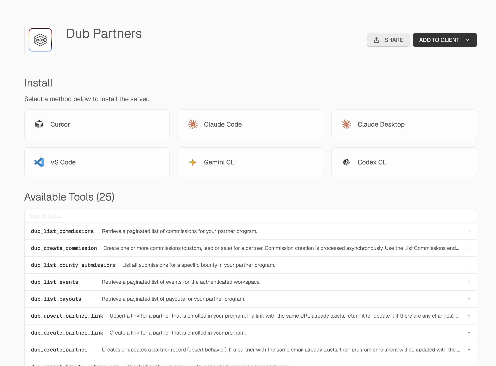

MCP is an open protocol that standardizes how applications provide context to LLMs. Among other benefits, it provides LLMs tools to act on your behalf. Dub offers both a [remote MCP server](#remote-mcp-server-recommended) and a [local MCP server](#local-mcp-server).

<Frame>
  
</Frame>

<Tip>
  Looking for the [Dub Links](https://dub.co/links) MCP server? Check out the
  [Dub Links MCP server docs](https://mcp.dub.sh/mcp/dub-links).
</Tip>

## Remote MCP Server (recommended)

Dub's MCP server is hosted at:

```
https://mcp.dub.sh/mcp/dub-partners
```

Connect any MCP client that supports remote servers (Streamable HTTP). There's nothing to install and no local process to run, which makes it the best option for web-based clients like Claude and hosted agent platforms.

When you connect, your client opens a browser window to log in to Dub and approve access using OAuth.

<Tabs>
  <Tab title="Claude">
    You can install the Dub MCP server as a [custom connector in
    Claude](https://claude.ai/new#settings/customize-connectors):

    <Frame>
      <video
        src="https://assets.dub.co/misc/install-claude-custom-connector.mp4"
        loop
        autoPlay
        muted
        playsInline
      />
    </Frame>

    To install only the MCP server, add it manually in Claude (web or desktop) from **Settings** > **Connectors** > **Add custom connector**:

    ```
    https://mcp.dub.sh/mcp/dub-partners
    ```

  </Tab>

  <Tab title="ChatGPT">
    You can install the Dub MCP server as a [ChatGPT
    plugin](https://chatgpt.com/plugins):

    <Tip>
      Make sure to enable [Developer Mode](https://developers.openai.com/api/docs/guides/developer-mode) in ChatGPT first before installing the plugin.
    </Tip>

    <Frame>
      <video
        src="https://assets.dub.co/misc/install-chatgpt-plugin.mp4"
        loop
        autoPlay
        muted
        playsInline
      />
    </Frame>

  </Tab>

  <Tab title="Codex">
    Add the server, then sign in to Dub in the browser window that opens:

    ```bash
    codex mcp add dub-partners --url https://mcp.dub.sh/mcp/dub-partners
    codex mcp login dub-partners
    ```

  </Tab>

  <Tab title="Cursor">
    Open the command palette and choose **Cursor Settings** → **MCP** → **Add new global MCP server**.

    ```json
    {
      "mcpServers": {
        "dub": {
          "url": "https://mcp.dub.sh/mcp/dub-partners"
        }
      }
    }
    ```

  </Tab>

  <Tab title="Copilot">
    To use GitHub Copilot in VS Code, add the following to your `settings.json`:

    ```json
    {
      "mcp": {
        "servers": {
          "dub": {
            "type": "http",
            "url": "https://mcp.dub.sh/mcp/dub-partners"
          }
        }
      }
    }
    ```

  </Tab>

  <Tab title="OpenCode">
    Add to your `opencode.json` config:

    ```json
    {
      "$schema": "https://opencode.ai/config.json",
      "mcp": {
        "servers": {
          "dub": {
            "type": "remote",
            "url": "https://mcp.dub.sh/mcp/dub-partners"
          }
        }
      }
    }
    ```

  </Tab>

  <Tab title="Warp">
    In Warp's Settings, navigate to **Agents** > **MCP servers**, and click **+ Add** to add a new server.

    ```json
    {
      "dub": {
        "serverUrl": "https://mcp.dub.sh/mcp/dub-partners"
      }
    }
    ```

  </Tab>
</Tabs>

### Use an API key instead of OAuth

If your client runs somewhere a browser login isn't possible (a server, CI, or a headless agent), pass a [Dub API key](/docs/api-reference/authentication#api-keys) in the `Mcp-Dub-Token` header instead of using OAuth.

<Tabs>
  <Tab title="Claude Code">
    ```bash
    claude mcp add dub-partners \
      --transport http https://mcp.dub.sh/mcp/dub-partners \
      --header "Mcp-Dub-Token: dub_xxxxxx"
    ```
  </Tab>

  <Tab title="JSON config">
    For clients configured with JSON (Cursor and others), add a `Mcp-Dub-Token` header:

    ```json
    {
      "mcpServers": {
        "dub": {
          "url": "https://mcp.dub.sh/mcp/dub-partners",
          "headers": {
            "Mcp-Dub-Token": "dub_xxxxxx"
          }
        }
      }
    }
    ```

  </Tab>
</Tabs>

### Managing connections

Each time someone in your workspace connects an MCP client using OAuth, Dub creates a connection for that user and client. You can review and revoke these connections from the Dub MCP integration page in your [workspace integration settings](https://app.dub.co/settings/integrations).

The **Connections** card lists every OAuth connection to the Dub MCP server, including:

- **User** – the workspace member who authorized the connection
- **Client** – the MCP client that was connected (e.g. Claude, ChatGPT, Cursor)
- **Dates** – when the connection was created
- **Scopes** – the permissions granted to the client

To remove a connection, click **Revoke** next to it. The client immediately loses access to your workspace and has to go through the OAuth flow again to reconnect.

Who can revoke a connection depends on your workspace role:

- **Owners** can revoke any connection in the workspace
- **Members** can only revoke their own connections

<Note>
  The Connections card only lists OAuth connections. If a client authenticates
  with the `Mcp-Dub-Token` header, revoke its access by deleting the [API
  key](/docs/api-reference/authentication#api-keys) instead.
</Note>

## Local MCP Server

Use the local server only if your MCP client can't connect to a remote HTTP endpoint. Most current clients can, so try the [remote server](#remote-mcp-server-recommended) first.

The local server runs [`mcp-remote`](https://www.npmjs.com/package/mcp-remote) through `npx`. It starts a process on your machine that forwards your client's requests to Dub's hosted server. You'll need [Node.js](https://nodejs.org) installed and a [Dub API key](/docs/api-reference/authentication#api-keys).

Choose your client below. Replace `dub_xxxxxx` with your API key.

<Note>
  Keep the header argument as `Mcp-Dub-Token:${MCP_DUB_TOKEN}`, with no space
  after the colon. `mcp-remote` fills in the key from the `MCP_DUB_TOKEN`
  environment variable, and some clients (Cursor, Codex, and Claude Desktop on
  Windows) break arguments that contain spaces.
</Note>

<Tabs>
  <Tab title="Claude Code">
    ```bash
    claude mcp add dub-partners \
      --env MCP_DUB_TOKEN=dub_xxxxxx \
      -- npx -y mcp-remote@0.1.25 https://mcp.dub.sh/mcp/dub-partners \
      --header "Mcp-Dub-Token:\${MCP_DUB_TOKEN}"
    ```
  </Tab>
  <Tab title="Codex">
    ```bash
    codex mcp add dub-partners \
      --env MCP_DUB_TOKEN=dub_xxxxxx \
      -- npx -y mcp-remote@0.1.25 https://mcp.dub.sh/mcp/dub-partners \
      --header "Mcp-Dub-Token:\${MCP_DUB_TOKEN}"
    ```
  </Tab>

  <Tab title="Cursor">
    Open the command palette and choose **Cursor Settings** → **MCP** → **Add new global MCP server**.

    ```json
    {
      "mcpServers": {
        "dub": {
          "command": "npx",
          "args": [
            "-y",
            "mcp-remote@0.1.25",
            "https://mcp.dub.sh/mcp/dub-partners",
            "--header",
            "Mcp-Dub-Token:${MCP_DUB_TOKEN}"
          ],
          "env": {
            "MCP_DUB_TOKEN": "dub_xxxxxx"
          }
        }
      }
    }
    ```

  </Tab>

  <Tab title="Claude Desktop">
    Open **Claude Desktop** settings → **Developer** tab → **Edit Config** and add the following:

    ```json
    {
      "mcpServers": {
        "dub": {
          "command": "npx",
          "args": [
            "-y",
            "mcp-remote@0.1.25",
            "https://mcp.dub.sh/mcp/dub-partners",
            "--header",
            "Mcp-Dub-Token:${MCP_DUB_TOKEN}"
          ],
          "env": {
            "MCP_DUB_TOKEN": "dub_xxxxxx"
          }
        }
      }
    }
    ```

  </Tab>

  <Tab title="Copilot">
    To use GitHub Copilot in VS Code, add the following to your `settings.json`:

    ```json
    {
      "mcp": {
        "servers": {
          "dub": {
            "command": "npx",
            "args": [
              "-y",
              "mcp-remote@0.1.25",
              "https://mcp.dub.sh/mcp/dub-partners",
              "--header",
              "Mcp-Dub-Token:${MCP_DUB_TOKEN}"
            ],
            "env": {
              "MCP_DUB_TOKEN": "dub_xxxxxx"
            }
          }
        }
      }
    }
    ```

  </Tab>

  <Tab title="Gemini CLI">
    Add to your `~/.gemini/settings.json`:

    ```json
    {
      "mcpServers": {
        "dub": {
          "command": "npx",
          "args": [
            "-y",
            "mcp-remote@0.1.25",
            "https://mcp.dub.sh/mcp/dub-partners",
            "--header",
            "Mcp-Dub-Token:${MCP_DUB_TOKEN}"
          ],
          "env": {
            "MCP_DUB_TOKEN": "dub_xxxxxx"
          }
        }
      }
    }
    ```
  </Tab>

  <Tab title="OpenCode">
    Add to your `opencode.json` config:

    ```json
    {
      "$schema": "https://opencode.ai/config.json",
      "mcp": {
        "servers": {
          "dub": {
            "type": "local",
            "command": [
              "npx",
              "-y",
              "mcp-remote@0.1.25",
              "https://mcp.dub.sh/mcp/dub-partners",
              "--header",
              "Mcp-Dub-Token:${MCP_DUB_TOKEN}"
            ],
            "environment": {
              "MCP_DUB_TOKEN": "dub_xxxxxx"
            }
          }
        }
      }
    }
    ```

  </Tab>

  <Tab title="Warp">
    In Warp's Settings, navigate to **Agents** > **MCP servers**, and click **+ Add** to add a new server.

    ```json
    {
      "dub": {
        "command": "npx",
        "args": [
          "-y",
          "mcp-remote@0.1.25",
          "https://mcp.dub.sh/mcp/dub-partners",
          "--header",
          "Mcp-Dub-Token:${MCP_DUB_TOKEN}"
        ],
        "env": {
          "MCP_DUB_TOKEN": "dub_xxxxxx"
        }
      }
    }
    ```

  </Tab>
</Tabs>

<Warning>
  Your API key is stored in plain text in your client's config file. Don't
  commit that file to a repository or share it. If a key leaks, [delete
  it](/docs/api-reference/authentication#api-keys) and create a new one.
</Warning>

## MCP Server tools

The Dub [MCP server](https://mcp.dub.sh/mcp/dub-partners) gives your AI agent native access to the full Dub platform through a single integration. You can manage your partner program, review applications, update commissions, and track attribution using natural language.

The server has 31 tools. The access column is the tool's own annotation, which clients use to decide what to confirm with you: **read** never changes anything, **write** creates or changes data, and **destructive** deletes data.

<AccordionGroup>
  <Accordion title="Partners — 5 tools">
    | Tool | Access | What it does |
    | --- | --- | --- |
    | <code style={{ whiteSpace: "nowrap" }}>dub_list_partners</code> | read | Lists the partners in your program, with filters and sorting by performance |
    | <code style={{ whiteSpace: "nowrap" }}>dub_create_partner</code> | write | Creates a partner and enrolls them in your program; returns the existing enrollment if the email is already enrolled |
    | <code style={{ whiteSpace: "nowrap" }}>dub_deactivate_partner</code> | write | Deactivates a partner and disables their links; their commissions and payouts stay intact |
    | <code style={{ whiteSpace: "nowrap" }}>dub_ban_partner</code> | write | Bans a partner, disables their links, and cancels their commissions |
    | <code style={{ whiteSpace: "nowrap" }}>dub_attribute_referring_partner</code> | write | Attributes a partner to the partner who referred them; both must be approved in your program |
  </Accordion>

  <Accordion title="Partner links — 2 tools">
    | Tool | Access | What it does |
    | --- | --- | --- |
    | <code style={{ whiteSpace: "nowrap" }}>dub_create_partner_link</code> | write | Creates a link for a partner enrolled in your program |
    | <code style={{ whiteSpace: "nowrap" }}>dub_upsert_partner_link</code> | write | Returns the partner's link for a URL, updating it if anything changed, or creates one |
  </Accordion>

  <Accordion title="Program applications — 3 tools">
    | Tool | Access | What it does |
    | --- | --- | --- |
    | <code style={{ whiteSpace: "nowrap" }}>dub_list_program_applications</code> | read | Lists applications to your program, filtered by pending, approved, or rejected |
    | <code style={{ whiteSpace: "nowrap" }}>dub_approve_program_application</code> | write | Approves an application, enrolls the partner in a group, and emails them |
    | <code style={{ whiteSpace: "nowrap" }}>dub_reject_program_application</code> | write | Rejects an application and emails the partner |
  </Accordion>

  <Accordion title="Analytics and events — 2 tools">
    | Tool | Access | What it does |
    | --- | --- | --- |
    | <code style={{ whiteSpace: "nowrap" }}>dub_retrieve_analytics</code> | read | Clicks, leads, and sales for a partner, a [partner group](/help/article/partner-groups), a link, or your workspace, as totals, a timeseries, or top lists |
    | <code style={{ whiteSpace: "nowrap" }}>dub_list_events</code> | read | Lists individual click, lead, and sale events |
  </Accordion>

  <Accordion title="Customers — 4 tools">
    | Tool | Access | What it does |
    | --- | --- | --- |
    | <code style={{ whiteSpace: "nowrap" }}>dub_get_customers</code> | read | Lists the customers in your workspace |
    | <code style={{ whiteSpace: "nowrap" }}>dub_get_customer</code> | read | Retrieves a customer by ID, or by external ID with an `ext_` prefix |
    | <code style={{ whiteSpace: "nowrap" }}>dub_update_customer</code> | write | Updates a customer |
    | <code style={{ whiteSpace: "nowrap" }}>dub_delete_customer</code> | destructive | Deletes a customer |
  </Accordion>

  <Accordion title="Tracking — 3 tools">
    | Tool | Access | What it does |
    | --- | --- | --- |
    | <code style={{ whiteSpace: "nowrap" }}>dub_track_lead</code> | write | Tracks a lead for a short link |
    | <code style={{ whiteSpace: "nowrap" }}>dub_track_sale</code> | write | Tracks a sale for a short link |
    | <code style={{ whiteSpace: "nowrap" }}>dub_track_open</code> | write | Tracks an app open from a Dub deep link on iOS or Android |
  </Accordion>

  <Accordion title="Commissions — 3 tools">
    | Tool | Access | What it does |
    | --- | --- | --- |
    | <code style={{ whiteSpace: "nowrap" }}>dub_list_commissions</code> | read | Lists the commissions in your program |
    | <code style={{ whiteSpace: "nowrap" }}>dub_create_commission</code> | write | Creates custom, lead, or sale commissions for a partner; a negative custom `amount` creates a clawback |
    | <code style={{ whiteSpace: "nowrap" }}>dub_update_commission</code> | write | Changes a commission's amount or status, for example after a refund or for fraud |
  </Accordion>

  <Accordion title="Bounties — 3 tools">
    | Tool | Access | What it does |
    | --- | --- | --- |
    | <code style={{ whiteSpace: "nowrap" }}>dub_list_bounty_submissions</code> | read | Lists the submissions for a bounty |
    | <code style={{ whiteSpace: "nowrap" }}>dub_approve_bounty_submission</code> | write | Approves a submission, optionally with a custom reward amount |
    | <code style={{ whiteSpace: "nowrap" }}>dub_reject_bounty_submission</code> | write | Rejects a submission with a reason and an optional note |
  </Accordion>

  <Accordion title="Discount codes — 3 tools">
    | Tool | Access | What it does |
    | --- | --- | --- |
    | <code style={{ whiteSpace: "nowrap" }}>dub_list_discount_codes</code> | read | Lists discount codes, filtered by partner, discount, or code |
    | <code style={{ whiteSpace: "nowrap" }}>dub_create_discount_code</code> | write | Creates a discount code for a partner whose group has a discount |
    | <code style={{ whiteSpace: "nowrap" }}>dub_delete_discount_code</code> | destructive | Deletes a discount code and disables it in your discount provider |
  </Accordion>

  <Accordion title="Payouts — 1 tool">
    | Tool | Access | What it does |
    | --- | --- | --- |
    | <code style={{ whiteSpace: "nowrap" }}>dub_list_payouts</code> | read | Lists the payouts for your program |
  </Accordion>

  <Accordion title="Messages — 2 tools">
    | Tool | Access | What it does |
    | --- | --- | --- |
    | <code style={{ whiteSpace: "nowrap" }}>dub_list_messages</code> | read | Lists messages between your program and its partners, newest first |
    | <code style={{ whiteSpace: "nowrap" }}>dub_create_message</code> | write | Sends a message to a partner, up to 10 a minute to the same partner |
  </Accordion>
</AccordionGroup>

## Example prompts

Try these prompts once the Dub MCP server is connected.

### Partners

- "Add jane@example.com to my program as a partner."
- "Show me the clicks, leads, and sales for jane@example.com in the last 30 days."
- "Who are my top 5 partners by total sales?"
- "Ban the partner with the email spam@example.com for fraud."
- "Show me my pending program applications and approve the one from alex@example.com."

### Links

- "Create a link for jane@example.com that points to https://example.com/pricing."
- "Create a link to https://example.com/black-friday for each of my top 10 partners."
- "Which of jane@example.com's links drove the most sales this quarter?"

### Commissions

- "Mark the commissions for invoice inv_123 as refunded."
- "Mark all pending commissions for spam@example.com as fraud."
