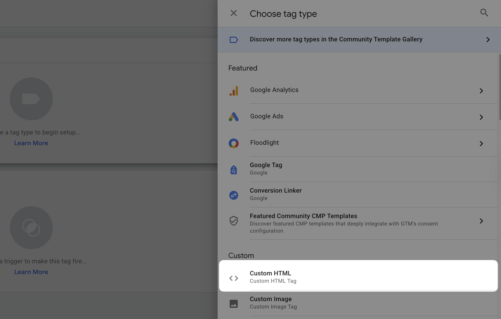
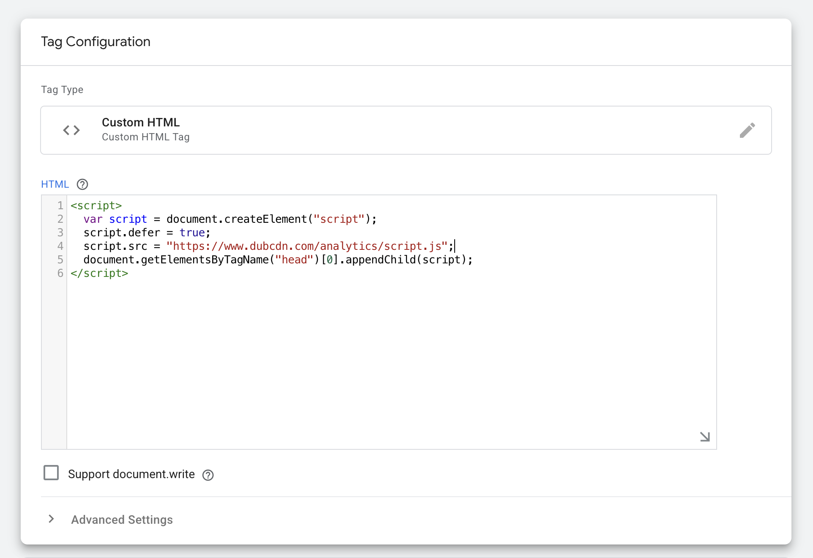

import DubAnalyticsParams from "/snippets/dub-analytics-params.mdx";
import DubClientInstallVerify from "/snippets/dub-client-install-verify.mdx";
import ClientSideClickTrackingAddendum from "/snippets/client-side-click-tracking-addendum.mdx";

This guide will walk you through the process of integrating Dub Analytics with Google Tag Manager (GTM).

<Steps>
  <Step title="Create a New Tag">
    First, navigate to your Google Tag Manager account and create a new tag:

    - Click on **Tags** in the left sidebar
    - Click the **New** button
    - Select **Custom HTML** as the tag type

    <Frame>
      
    </Frame>

  </Step>

  <Step title="Add the Dub Analytics Script">
    In the Custom HTML section, you'll need to add the Dub Analytics script. Copy and paste the following code into the **HTML** field:

    ```js
    <script>
      var script = document.createElement("script");
      script.defer = true;
      script.src = "https://www.dubcdn.com/analytics/script.js";
      document.getElementsByTagName("head")[0].appendChild(script);
    </script>
    ```

    <Frame>
      
    </Frame>


    Then, set up [client-side click-tracking](/docs/sdks/client-side/features/click-tracking) by setting the `data-domains` property to the custom domain you use for your short links on Dub.

    <Warning>
      Don't skip this step. Client-side click tracking helps prevent click ID spoofing, where someone fabricates or reuses a click ID to claim credit for conversions they didn't drive. With client-side click tracking, the Dub Analytics script records each click itself, and Dub only accepts those clicks from the hostnames on your workspace's **Allowed Hostnames** list.
    </Warning>

    ```js
    <script>
      ...
      var script = document.createElement("script");
      script.defer = true;
      script.src = "https://www.dubcdn.com/analytics/script.js";
      script.dataset.domains = JSON.stringify({ refer: "refer.yourdomain.com" }); // Add this line to match the short domain you're using for your referral links
      document.getElementsByTagName("head")[0].appendChild(script);
    </script>
    ```

  </Step>

  <Step title="Configure the Trigger">
    To ensure the analytics script loads on all pages:

    - Click on the **Triggering** section
    - Select **All Pages** as the trigger type
    - This will make the tag fire on every page load

  </Step>

  <Step title="Save and Publish">
    - Name your tag **Dub Analytics**
    - Click **Save** to store your changes
    - Click **Submit** to create a new version
    - Finally, click **Publish** to activate the tag on your website

  </Step>
</Steps>

<DubClientInstallVerify />

## Concepts

You can pass the following props to the Dub Analytics script to customize its behavior:

<DubAnalyticsParams />
