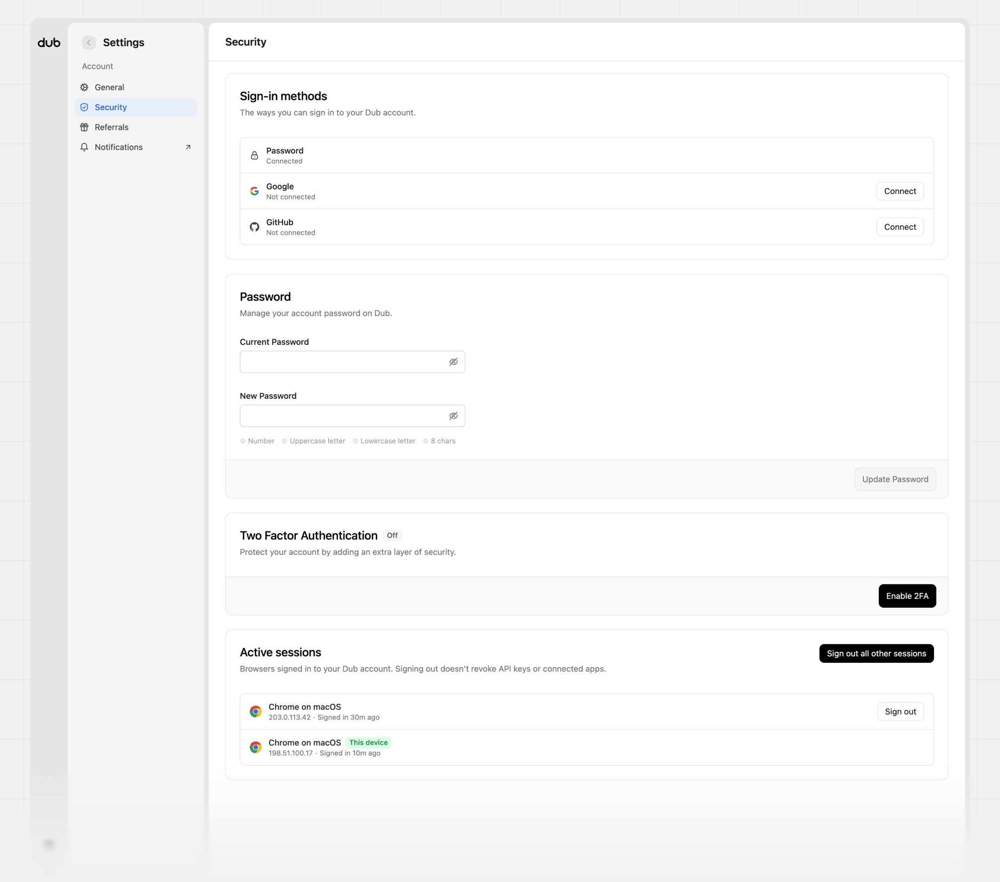
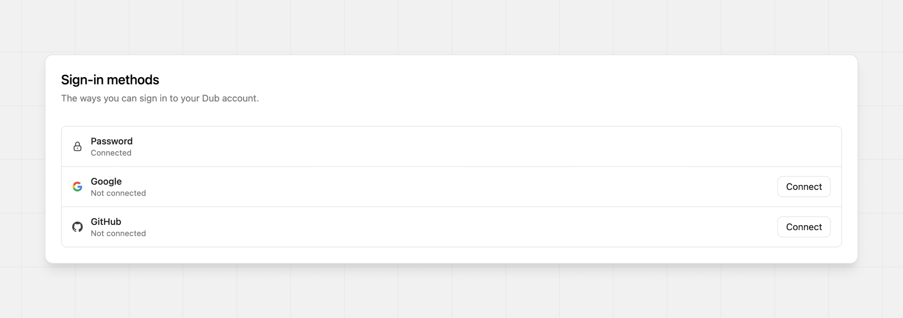
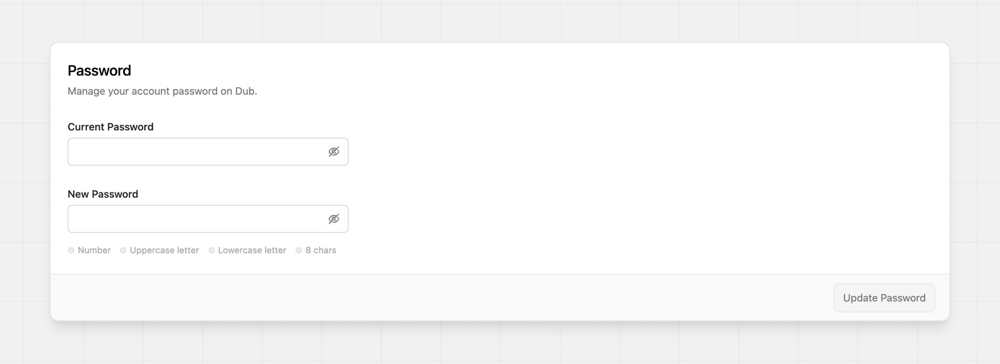
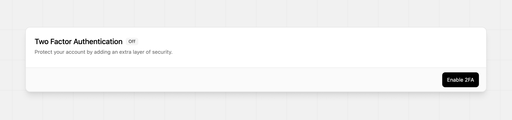
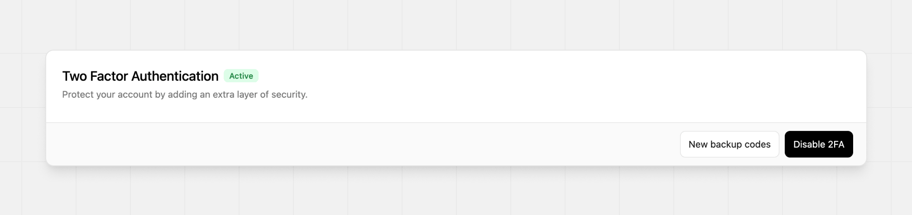
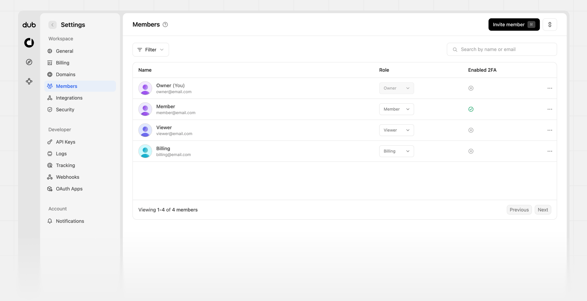
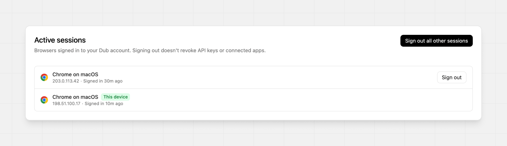

The **Security** tab in your account settings is where you control how you sign in to Dub and where your account is signed in. From there, you can:

- [Manage your sign-in methods](#sign-in-methods), such as your password, Google, and GitHub.
- [Set up two-factor authentication](#two-factor-authentication) to require a code from an authenticator app when you sign in.
- [Review your active sessions](#active-sessions) and sign out of browsers you no longer use.

To open it, navigate to your [account settings](https://app.dub.co/account/settings) on Dub and select the **Security** tab in the sidebar.

<Frame>
  
</Frame>

## Sign-in methods

The **Sign-in methods** card lists the ways you can sign in to your Dub account, and whether each one is **Connected** or **Not connected**.

<Frame>
  
</Frame>

### Connecting Google or GitHub

To add Google or GitHub as a sign-in method, click **Connect** next to it and sign in with that provider.

The Google or GitHub account needs to use the same email address as your Dub account, and that email needs to be verified with the provider. An account that's already connected to another Dub user can't be connected.

<Note>
  If your organization requires [SAML
  SSO](/help/article/okta-saml), you can't connect Google or GitHub.
</Note>

### Disconnecting Google or GitHub

To remove Google or GitHub as a sign-in method:

1. Click **Disconnect** next to it.
2. Confirm by clicking **Disconnect** in the prompt.

You won't be able to sign in with that provider until you connect it again. You can't disconnect your only sign-in method.

Other sign-in methods, such as your password or SAML, are listed when they're in use, but they can't be disconnected.

### Setting or changing your password

Use the **Password** card, below your sign-in methods:

<Frame>
  
</Frame>

- **If you don't have a password yet**, click **Create account password**. We'll email you instructions to set one.
- **If you already have a password**, enter your current password and a new password, then click **Update Password**.

## Two-factor authentication

Two-factor authentication (2FA) adds a second step when you sign in to Dub. After you sign in as usual, Dub asks for a 6-digit code from an authenticator app on your phone, so someone who only has your password or access to your email can't get into your account.

You'll need an authenticator app, such as 1Password, Google Authenticator, or Authy.

### Enabling 2FA

1. In the **Two Factor Authentication** card, click **Enable 2FA**.

<Frame>
  
</Frame>

2. If your account has a password, enter your current password and click **Continue**.
3. Scan the QR code with your authenticator app. If you can't scan it, enter the key shown below the QR code instead.
4. Enter the 6-digit code from your authenticator app and click **Enable 2FA**.
5. Save your backup codes, then click **Done**.

The card now shows an **Active** badge.

<Frame>
  
</Frame>

<Warning>
  Your backup codes are only shown once. Use **Copy**, **Download**, or
  **Print** to save them somewhere safe before you close the window.
</Warning>

When you enable 2FA, you're signed out on all your other devices. The browser you're using stays signed in.

### Signing in with 2FA

Once 2FA is enabled, Dub asks for a code every time you sign in with your password, a login link, Google, or GitHub.

1. Sign in as you normally would.
2. Enter the 6-digit code from your authenticator app.

If you don't have your authenticator app with you, click **Use a backup code** and enter one of your backup codes instead. Each backup code only works once.

### Generating new backup codes

If you've used most of your backup codes, or you think someone else has seen them, you can replace them:

1. In the **Two Factor Authentication** card, click **New backup codes**.
2. If your account has a password, enter your current password. Then click **Continue**.
3. Save your new backup codes, then click **Done**.

Your old backup codes stop working as soon as the new ones are generated.

### Disabling 2FA

1. In the **Two Factor Authentication** card, click **Disable 2FA**.
2. If your account has a password, enter your current password. Then click **Continue**.

The card shows an **Off** badge, and you'll no longer be asked for a code when you sign in.

### What if I lose access to my authenticator app?

Sign in with one of your backup codes, then disable 2FA and enable it again to connect your new device.

If you don't have your backup codes either, [contact our support team](https://dub.co/contact/support). After confirming it's you, we can reset 2FA on your account. A reset turns off 2FA and signs you out on every device, and you can enable 2FA again from the **Security** tab.

### Checking which teammates have 2FA enabled

The **Members** page in your workspace settings has an **Enabled 2FA** column, which shows whether each teammate has turned on 2FA for their Dub account.

<Frame>
  
</Frame>

<Tip>
  2FA is set per account, not per workspace. Each teammate needs to enable it
  from their own account settings.
</Tip>

## Active sessions

The **Active sessions** card shows every browser that is currently signed in to your Dub account. You can use it to check where your account is in use and to sign out of any session remotely, for example if you signed in on a shared computer or no longer have access to a device.

<Frame>
  
</Frame>

Each session in the list shows:

- **Browser and operating system**: for example, Chrome on macOS or Safari on iOS.
- **IP address**: the IP address the session signed in from.
- **Sign-in time**: how long ago the session signed in.

The session you're currently using is marked with a **This device** badge.

### Signing out of a single session

To sign out of a specific browser, click **Sign out** next to that session. That browser will need to sign in again to access your Dub account.

### Signing out of all other sessions

To sign out everywhere except the browser you're currently using:

1. Click **Sign out all other sessions** in the top right of the **Active sessions** card.
2. Confirm the action in the prompt.

Your current session (the one marked **This device**) stays signed in.

<Tip>
  If you see a session you don't recognize, sign out of it and then update your
  password from the **Password** card in the same **Security** tab.
</Tip>

### What about API keys and connected apps?

Signing out of a session only affects browsers signed in to your Dub account. It doesn't revoke your API keys or disconnect any connected apps, so those will keep working.

If you have any questions or need further assistance, please [contact our support team](https://dub.co/contact/support).
