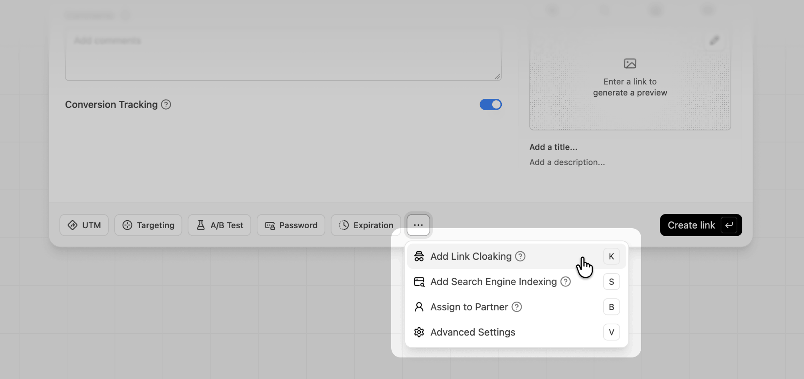
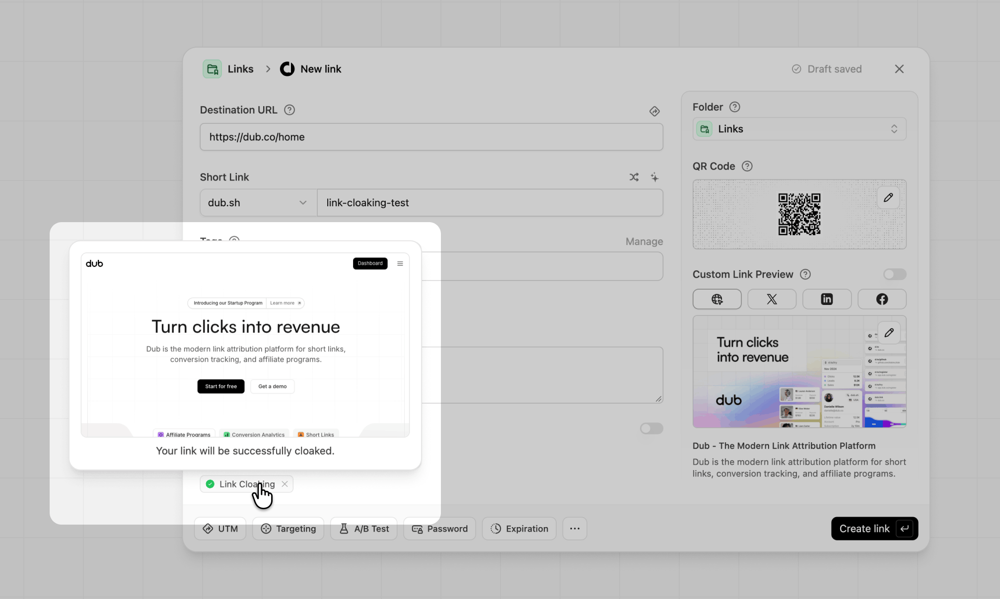

import { ImageLink } from "/snippets/components/image-link.jsx";

<Tip>
  This feature is only available on [Pro plans and
  above](https://dub.co/pricing).
</Tip>

With link cloaking, your short link stays in the visitor's browser address bar instead of the destination URL.

To enable link cloaking, click on the more options button `...` in the link builder and select **Add Link Cloaking**. You can also press `K` while the link builder is open.

<Frame>
  
</Frame>

When a visitor opens a cloaked link, Dub loads the destination page inside a full-screen frame on your short domain. The address bar keeps showing your short link, while the page content, browser tab title, and favicon come from the destination.

<Frame>
  
</Frame>

## Checking if your link can be cloaked

After you turn on link cloaking, the **Link Cloaking** badge in the link builder checks the destination URL for you:

- **Green check**: the destination can be cloaked. Hover over the badge to see a preview of how the page will look.
- **Amber warning**: the destination blocks being shown in a frame, so visitors will see a blank or error page. See [link cloaking with security headers](#link-cloaking-with-security-headers) to fix this for sites you control.

<Frame>
  
</Frame>

Always open the created short link yourself to test it before sharing it.

## When to use link cloaking

Link cloaking works best when **you own or control the destination**. That way you can make sure it can be framed and it's clear to visitors who they're dealing with. Some good examples:

- **Branded URLs for pages hosted elsewhere**: show `go.acme.com/launch` instead of `acme-launch.vercel.app` for a campaign microsite, waitlist, or event page your team hosts on a different domain.
- **Clean URLs for long, parameter-heavy pages**: hide UTM parameters or long query strings on your own site, so `acme.com/pricing?utm_source=newsletter&utm_campaign=q4-promo` shows up as `acme.link/pricing`.
- **Printed and spoken links**: keep a short, memorable link on screen for QR codes on packaging, conference booths, or podcast ads, even after visitors land on the page.
- **Consistent branding across your own properties**: send visitors to your docs, help center, or status page on another subdomain while keeping a single branded domain in the address bar.
- **Links that outlast a hosting change**: visitors who bookmark or copy the address get your short link, not the host's URL. If you later move a microsite to a different host, update the destination URL and existing bookmarks keep working.

## When to avoid link cloaking

Cloaking hides where a visitor actually is. That's fine for your own pages, but can break things or break the rules elsewhere. Avoid it for:

- **Affiliate links**: many affiliate programs don't allow cloaking. For example, [Amazon Associates](https://affiliate-program.amazon.com/help/operating/agreement) doesn't let you cloak or obscure links so visitors can't tell they go to Amazon. Regardless of the program, you must disclose affiliate links clearly. A regular short link (with cloaking turned off) is the safer option.
- **Ad destinations**: ad platforms like Google Ads and Meta review your ad's final URL and expect it to match the site visitors land on. A framed destination can be flagged as a destination mismatch, or as an attempt to get around ad review. Use a regular short link or the destination URL directly.
- **Pages you don't control**: most large sites (social networks, marketplaces, banks, and many SaaS apps) block being shown in a frame, so the link won't work. Even when it does, showing someone else's page under your domain can confuse visitors.
- **Logins, checkouts, and forms**: browsers restrict cookies and storage inside frames from other sites, so sign-in, payment, and form flows often fail. Payment providers also commonly block framing for security.
- **Links where visitors need to see the real destination to trust it**: if a visitor would reasonably want to verify where they are, for example before entering personal details, don't hide it.
- **Links with device or geo targeting**: link cloaking takes priority over [device targeting](/help/article/device-targeting) and [geo targeting](/help/article/geo-targeting). If cloaking is on, every visitor sees the main destination URL and your targeting rules are ignored.
- **App links**: a framed page can't open your iOS or Android app, so visitors stay on the web page instead.
- **Video, calls, and other device features**: the framed page can't use fullscreen video, camera, microphone, location, or copy-to-clipboard buttons.
- **Conversion tracking and partner links**: [conversion tracking](/help/article/dub-conversions) relies on a cookie set on the destination site. Inside a frame, many browsers treat that cookie as third-party and block it, so leads and sales may not be attributed. This includes partner and referral links in your partner program.

## Things to keep in mind

- **The address bar doesn't change while visitors browse**: if a visitor clicks around inside the cloaked page, the address bar keeps showing your short link. Refreshing the page or sharing the URL sends people back to the original destination, not the page they were on.
- **Dub tracks the first click only**: Dub records a click when the cloaked link is opened. Navigation inside the framed page isn't tracked as additional clicks.
- **`https` is required**: your short link is served over `https`, and browsers won't load an `http` page inside it. Make sure your destination URL uses `https`.

## How link cloaking affects SEO

Cloaked links don't help or hurt the SEO of your destination site. Here's why:

- **Cloaked links are never indexed**: Dub adds a `noindex` tag to every cloaked page, even if you've turned on [search engine indexing](/help/article/how-noindex-works) for the link. Search engines won't show your cloaked short link in results.
- **Your short domain doesn't get credit for the destination's content**: search engines attribute framed content to the destination URL, not to your short link.
- **This isn't the same as "cloaking" in Google's spam policies**: Google's [spam policies](https://developers.google.com/search/docs/essentials/spam-policies) on cloaking and sneaky redirects cover showing search engines different content than users. Dub shows the same page to both. That said, using any link to disguise where visitors end up, especially in ads or emails, can still get flagged.

If you want a short link to rank or pass SEO value, use a regular short link without cloaking.

## How Dub prevents abuse

Scammers sometimes use cloaking to make a malicious page look like it belongs to a trusted brand. To prevent this, Dub has several safeguards:

- **Paid plans only**: link cloaking is only available on Pro plans and above.
- **Malicious URL scanning**: links on Dub-branded domains like `dub.sh` and `dub.link` are checked when they're created or updated, against a blocklist of known malicious domains and an automated review for phishing, brand impersonation, malware, and nested URL shorteners. Links that fail are rejected.
- **Link inspector**: anyone can see a short link's real destination, including a cloaked one, by adding a `+` to the end of the link (for example, `d.to/github+`). [Learn more](/help/article/how-to-check-link-destination).
- **Reporting and takedowns**: anyone can report a suspicious link from the link inspector. We review every report and take down links that violate our [Terms of Service](https://dub.co/legal/terms#3-fair-use).

## Link cloaking with security headers

Some websites block being shown in a frame using these security headers:

- `X-Frame-Options` set to `DENY` or `SAMEORIGIN`
- `Content-Security-Policy` with a `frame-ancestors` directive that doesn't include your short domain (for example, `frame-ancestors 'none'` or `frame-ancestors 'self'`)

If you have control over the destination URL that you are cloaking, you can allow your Dub short domain to frame it while still blocking iframe embedding everywhere else.

### Adding security headers to your destination URL

To do this, you need to allowlist your [Dub short domain](/help/article/how-to-add-custom-domain) as an allowed origin on your site by adding the following response header to your site:

```bash
Content-Security-Policy: frame-ancestors 'self' [shortdomain.com]
```

For example, if your Dub short domain is `dub.sh`, you would need to add the following header to your destination URL:

```bash
Content-Security-Policy: frame-ancestors 'self' dub.sh
```

If your site already sends an `X-Frame-Options` header, you can keep it. Modern browsers ignore `X-Frame-Options` when `frame-ancestors` is set, so your cloaked links will still work. Older browsers that don't support `frame-ancestors` will keep using `X-Frame-Options`, which protects your site from clickjacking there, but means cloaking won't work in those browsers.

### Allowlisting multiple domains

You can also allowlist multiple domains by separating them with a space:

```bash
Content-Security-Policy: frame-ancestors 'self' dub.sh otherdomain.com
```

This will ensure that your site cannot be embedded in third-party sites but can still be cloaked by your Dub short domain.

### Secure link cloaking demo

Here's a demo of how this works:

<ImageLink
  alt="Link cloaking with security headers demo"
  src="https://assets.dub.co/help/link-cloaking-security-demo.png"
  href="https://link-cloaking-security.vercel.app"
  cta="View demo site ↗"
/>

- Code example: [git.new/zAD0CkJ](https://git.new/zAD0CkJ)
- Demo site: [link-cloaking-security.vercel.app](https://link-cloaking-security.vercel.app)
- Demo short link (enabled): [dub.link/secure-cloak](https://dub.link/secure-cloak)
- Any other iframes (disabled): [iframetester.com/?url=https://link-cloaking-security.vercel.app](https://iframetester.com/?url=https://link-cloaking-security.vercel.app)
