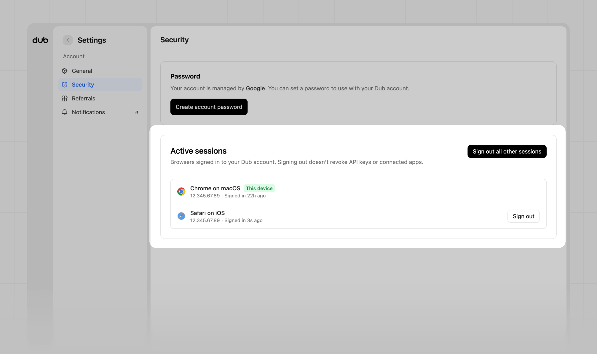

The **Active sessions** card shows every browser that is currently signed in to your Dub account. You can use it to check where your account is in use and to sign out of any session remotely, for example if you signed in on a shared computer or no longer have access to a device.

## Viewing your active sessions

1. Navigate to your [account settings](https://app.dub.co/account/settings) on Dub.
2. Select the **Security** tab in the sidebar.
3. Scroll to the **Active sessions** card.

<Frame>
  
</Frame>

Each session in the list shows:

- **Browser and operating system**: for example, Chrome on macOS or Safari on iOS.
- **IP address**: the IP address the session signed in from.
- **Sign-in time**: how long ago the session signed in.

The session you're currently using is marked with a **This device** badge.

## Signing out of a single session

To sign out of a specific browser, click **Sign out** next to that session. That browser will need to sign in again to access your Dub account.

## Signing out of all other sessions

To sign out everywhere except the browser you're currently using:

1. Click **Sign out all other sessions** in the top right of the **Active sessions** card.
2. Confirm the action in the prompt.

Your current session (the one marked **This device**) stays signed in.

<Tip>
  If you see a session you don't recognize, sign out of it and then update your
  password from the **Password** card in the same **Security** tab.
</Tip>

## What about API keys and connected apps?

Signing out of a session only affects browsers signed in to your Dub account. It doesn't revoke your API keys or disconnect any connected apps, so those will keep working.

If you have any questions or need further assistance, please [contact our support team](https://dub.co/contact/support).
