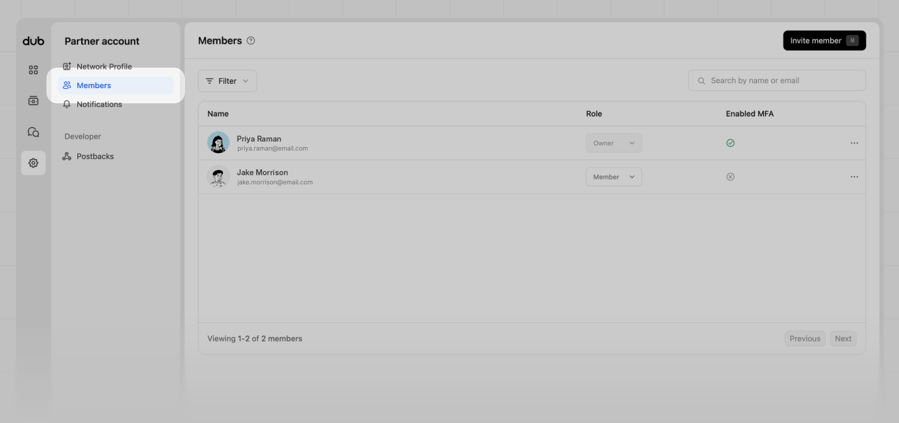
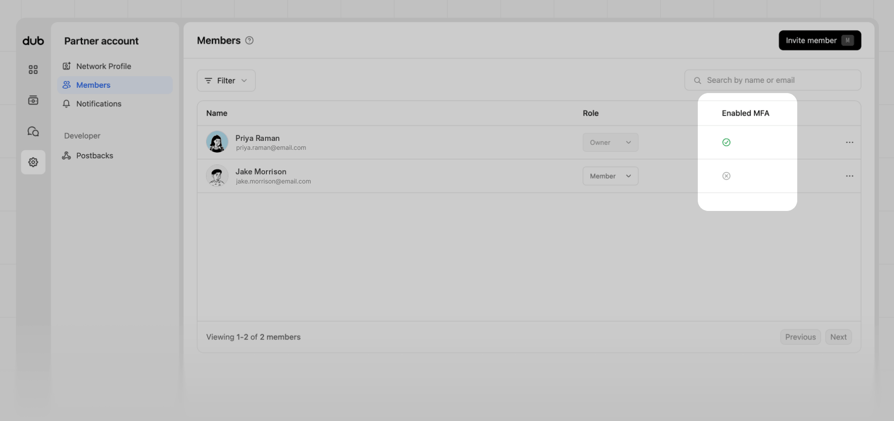

On Dub, Partner teams let you share access to your [Dub partner profile](/help/article/partner-profile) with the people you work with. This is useful for creators, agencies, or anyone who wants more than one person managing partner activity.

## Where to manage your team

To manage your partner team, select the **Settings** icon in the left sidebar, then navigate to **Members** under **Partner account**.

<Frame>
  
</Frame>

This view lists everyone with access, including their email, assigned role, and whether they've enabled multi-factor authentication (MFA).

### Checking which members have MFA enabled

The **Enabled MFA** column shows whether each member has turned on [multi-factor authentication](/help/article/account-security#multi-factor-authentication) for their Dub account. A green check means MFA is on; a gray cross means it's off.

<Frame>
  
</Frame>

<Tip>
  MFA is set per account, not per partner team. Each member needs to enable it
  from their own account settings.
</Tip>

## Roles and permissions

Partner team members support two role types: owner and member.

### Owner

The Owner has full control of the partner account. This includes:

- [Updating partner profile settings](/help/article/partner-profile)
- Managing team members (inviting and removing members)
- [Managing payout details](/help/article/receiving-payouts)

### Member

Members have standard access. They can view and manage partner activity across all programs, but cannot manage team members or payout details.

## Inviting a new member

To invite a new member to your partner team, click the **Invite member** button in the top right.

<Frame>
  
</Frame>

Enter the member's email address, and select their role. You can invite more than one member at a time, and they'll each receive their own invite email to accept membership.

<Frame>
  
</Frame>

<Info>You can only invite up to 10 teammates per partner team.</Info>

## Changing a role

Only Owner-roled members in a partner team can change another member’s role. To change a member's role, click the role dropdown in the members table and select a new role.

<Frame>
  
</Frame>

This will open the confirmation modal, where you can confirm the update:

<Frame>
  
</Frame>

## Removing a member

To remove a member from your team, click the `⋯` dropdown and select **Remove member**.

<Frame>
  
</Frame>

This deletes the team member, and the person can no longer sign in to your partner profile.
