<Tip>
  This feature is only available on [Advanced plans and
  above](https://dub.co/pricing).
</Tip>

Submitted leads let partners manually submit prospective customers to your program, even when the lead did not come through a tracked partner link.

<Frame>
  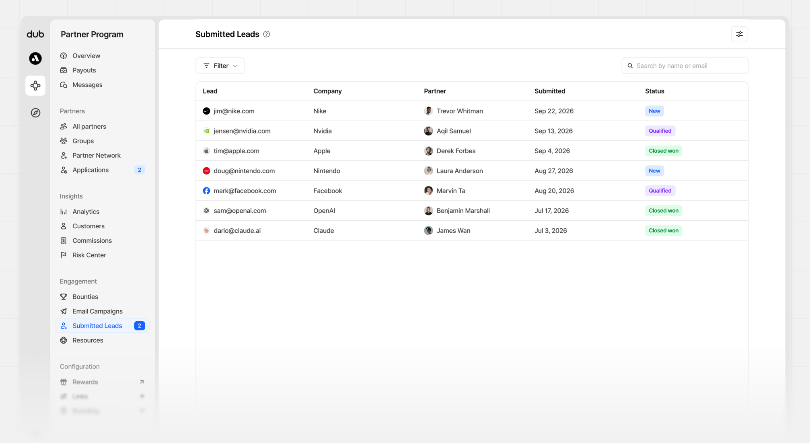
</Frame>

They are different from tracked leads since they are not created automatically by a partner link, but rather manually submitted by the partner.

They start as a "submitted lead" record, and only become an attributed lead or sale in Dub when you update their status. This makes submitted leads useful for sales-assisted workflows where partners introduce prospects before a tracked signup or purchase happens.

## Setting up the submitted lead form

Partners submit leads through a form in their partner dashboard. You control which [partner groups](/help/article/partner-groups) can use the form and which fields it asks for.

To edit the form, go to the **Submitted Leads** page in your Partner Program navigation and click the form settings button in the top right.

This opens the **Edit submitted lead form** panel, which has two sections: **Group access** and **Form fields**.

<Frame>
  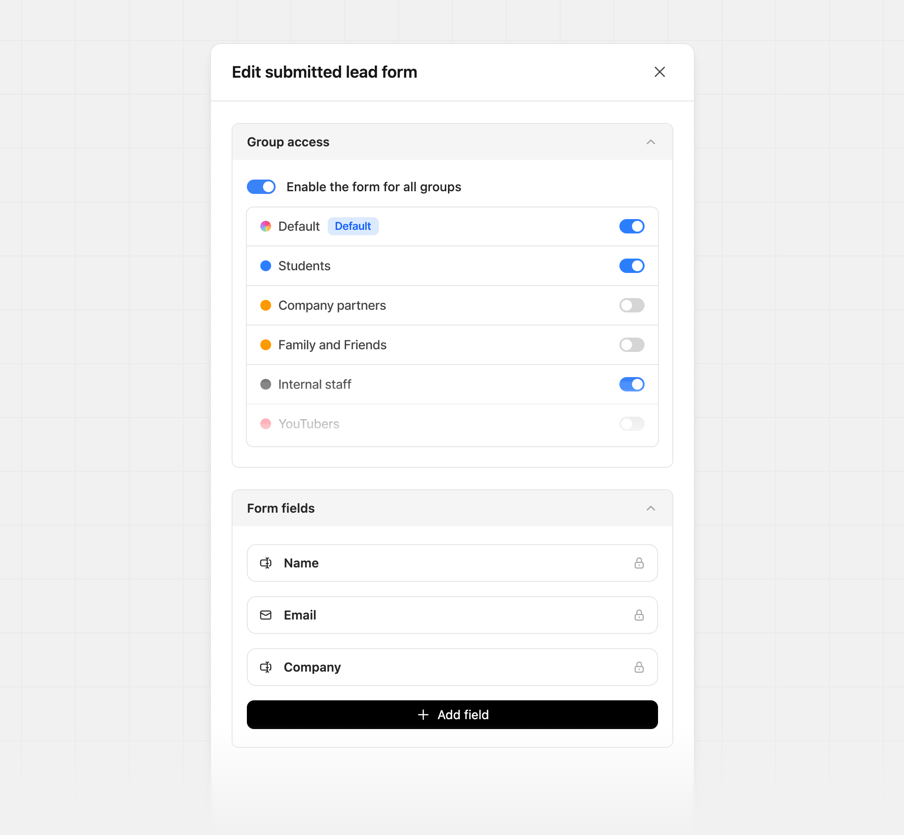
</Frame>

Enabling a group is not enough on its own. Partners in that group only see the form once the group also has a reward set up for submitted leads. Learn how to [create rewards for submitted leads](#creating-rewards-for-submitted-leads).

<Note>
  Editing the form requires a workspace role that can manage partner groups.
</Note>

### Choosing which groups can submit leads

Under **Group access**, turn the form on or off for each partner group. Only partners in an enabled group can submit leads.

To turn it on for every group at once, switch on **Enable the form for all groups**.

All enabled groups share the same form, so any change to the fields applies to every group.

### Adding form fields

Every form starts with three fields: **Name**, **Email**, and **Company**. These are always required and can't be changed or removed.

To collect more information, click **Add field**. A new field appears at the bottom of the list.

<Frame>
  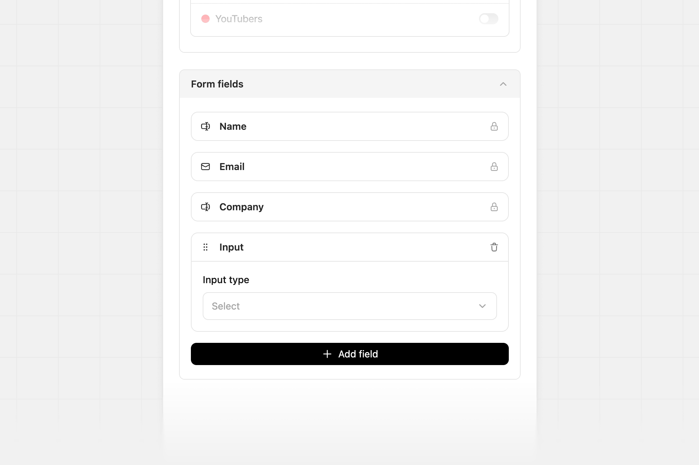
</Frame>

Choose an **Input type**, then enter a **Field label**.

<Frame>
  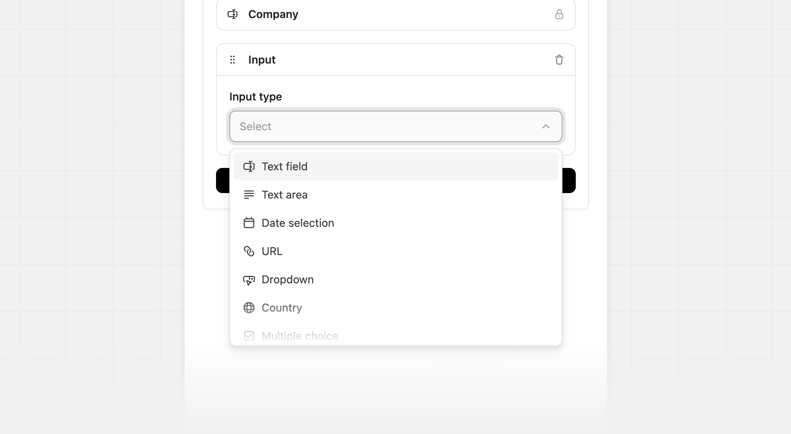
</Frame>

| Input type          | What partners enter                            | Example                |
| ------------------- | ---------------------------------------------- | ---------------------- |
| **Text field**      | A single line of text                          | Job title              |
| **Text area**       | Longer, multi-line text                        | Notes about the lead   |
| **Date selection**  | A date                                         | Expected close date    |
| **URL**             | A link                                         | Company website        |
| **Dropdown**        | One option from a dropdown list                | Company size           |
| **Country**         | A country                                      | Company headquarters   |
| **Multiple choice** | One option, or several, from a list of choices | Products of interest   |
| **Number**          | A number                                       | Number of seats needed |

Every field also has a **Required** toggle. Turn it on if partners must fill in the field before they can submit the lead.

<Warning>
  Changing a field's input type keeps its label and **Required** setting, but
  clears the other settings, such as options and limits.
</Warning>

### Reordering and removing fields

Drag a field by its handle to change where it appears in the form. Custom fields always appear after **Name**, **Email**, and **Company**.

To remove a field, hover over it and click the trash icon.

When you're done, click **Save**. Partners in the enabled groups see the updated form the next time they submit a lead.

## Creating rewards for submitted leads

To create or update lead rewards, go to your program's [partner groups](/help/article/partner-groups), open the group you want to configure, and edit its rewards. This is where you create:

- **Lead rewards** for leads that reach `Qualified` status
- **Sale rewards** for leads that reach `Closed won` status

### Lead reward

Open the lead reward editor, and add a condition to pay out when the customer source is `submitted lead`. If this customer reaches **Qualified**, the partner then earns a reward.

<Frame>
  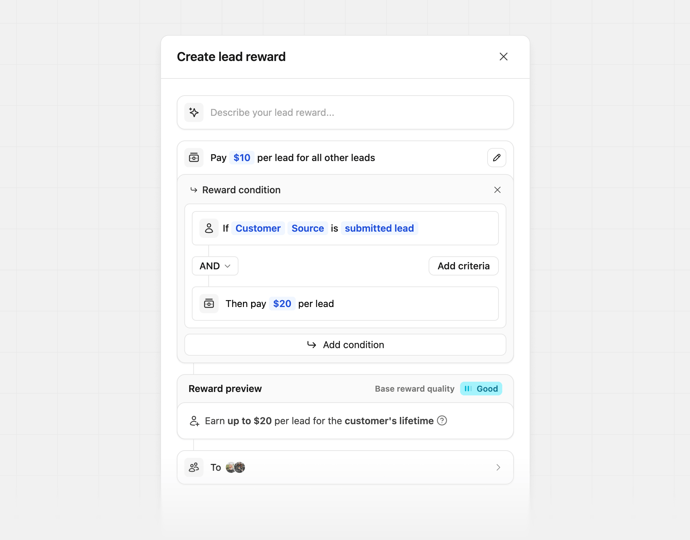
</Frame>

### Sale reward

Open the sale reward editor, and add a condition on `Customer` `Source`, and select the source that matches how your deals are closed:

- **`closed won deal`**: Pay out when you mark a submitted lead as **Closed won** in Dub. This creates the customer and sale records, and the partner is rewarded. Use this if you manage the deal stage directly from the [Submitted leads](#updating-lead-statuses) page.
- **`HubSpot closed won deal`**: Pay out when a deal reaches your closed won stage in HubSpot. Use this if you track your sales pipeline in HubSpot with the [HubSpot integration](/docs/integrations/hubspot#when-a-deal-is-closed-sale-event).

Choosing one of these sources keeps these rewards separate from `tracked sale` rewards, which apply to sales tracked via the API or the [Stripe integration](/docs/integrations/stripe). Learn more about [sale reward conditions](/help/article/sale-rewards#customer-attributes).

<Frame>
  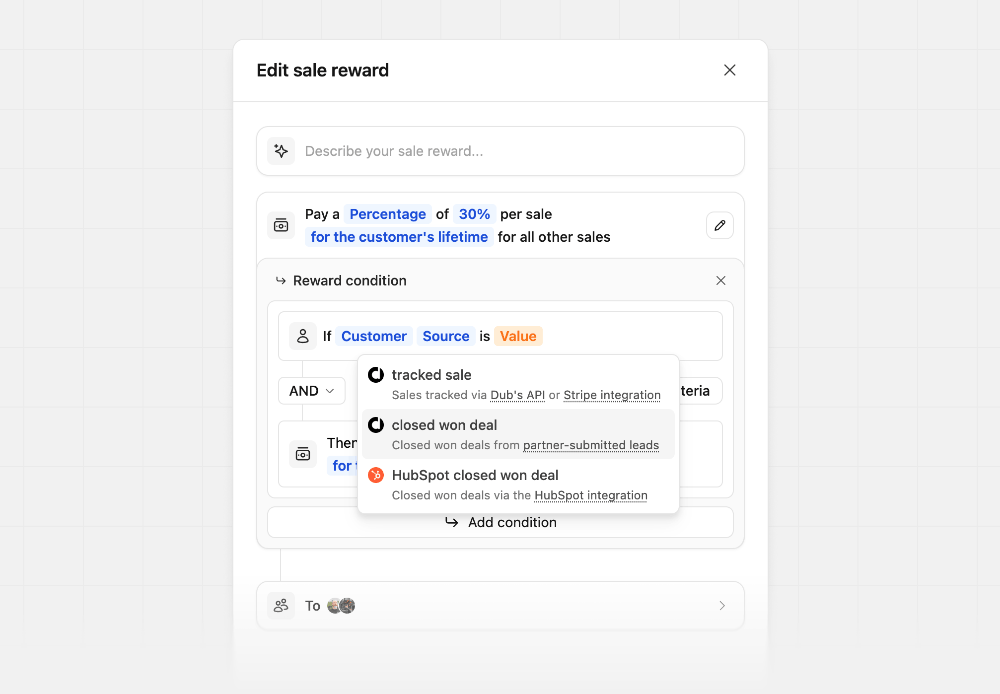
</Frame>

## Managing submitted leads

To view all submitted leads, go to **Submitted Leads** page in your Partner Program navigation.

<Frame>
  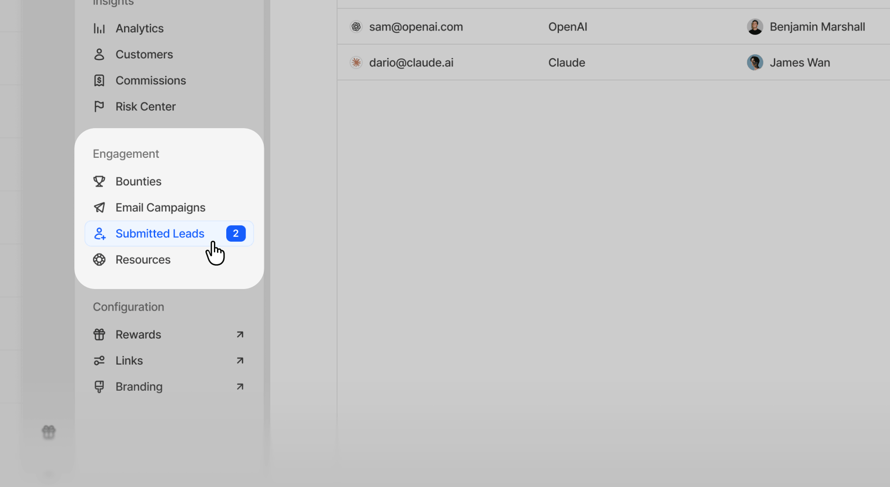
</Frame>

This view will show all partner-submitted leads in one table, including:

- Lead email
- Company
- Submitting partner
- Submitted date
- [Current status](#submitted-lead-statuses)

Click any row to open the lead details panel and review the submission more closely.

<Frame>
  
</Frame>

If you want to review converted customers after a lead has been qualified or closed won, see [Customer insights](/help/article/customer-insights).

## Reviewing submitted leads

When you click a lead row in the **Submitted leads** table, a drawer view opens with the full lead record.

<Frame>
  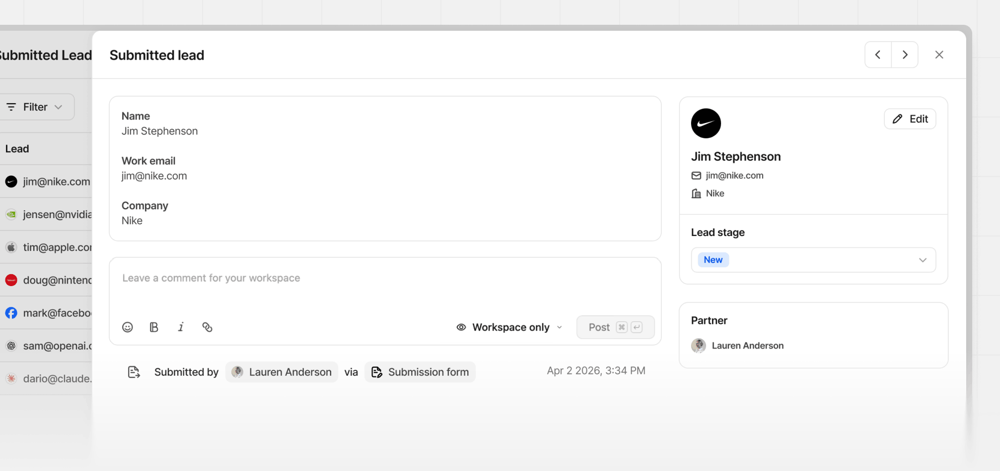
</Frame>

This drawer is designed for quickly reviewing the submission, updating the lead stage, and seeing the history of changes without leaving the table. You're also able to edit the lead details by clicking the **Edit** button on the lead details card.

## Commenting on submitted leads

Use comments to keep notes on a submitted lead and share updates with the partner who submitted it. In the lead drawer, click the **Comments** tab next to **Lead Details**.

<Frame>
  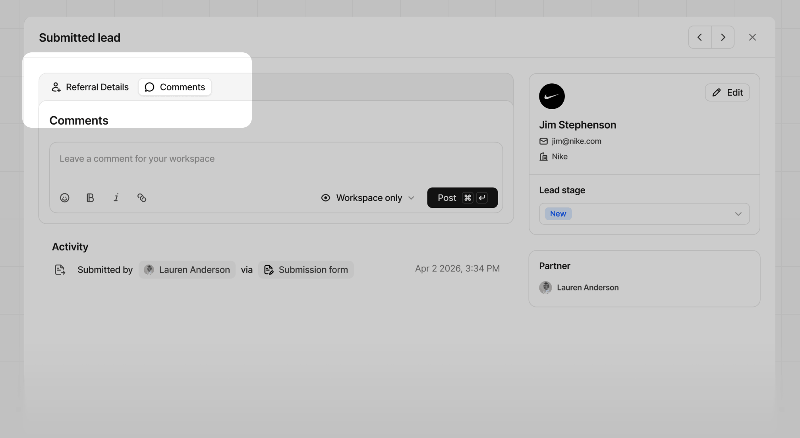
</Frame>

### Choosing who can see a comment

Before posting, use the visibility selector next to the **Post** button to choose who can see the comment:

| Visibility                | Who can see it                                                                     |
| ------------------------- | ---------------------------------------------------------------------------------- |
| **Workspace only**        | Only members of your workspace. Use this for internal notes about the lead.        |
| **Workspace and partner** | Your workspace and the partner who submitted the lead, in their partner dashboard. |

Comments default to **Workspace only**. When **Workspace and partner** is selected, the comment input turns orange, and the posted comment shows a **Partner visible** badge so it's easy to tell apart from internal notes.

<Frame>
  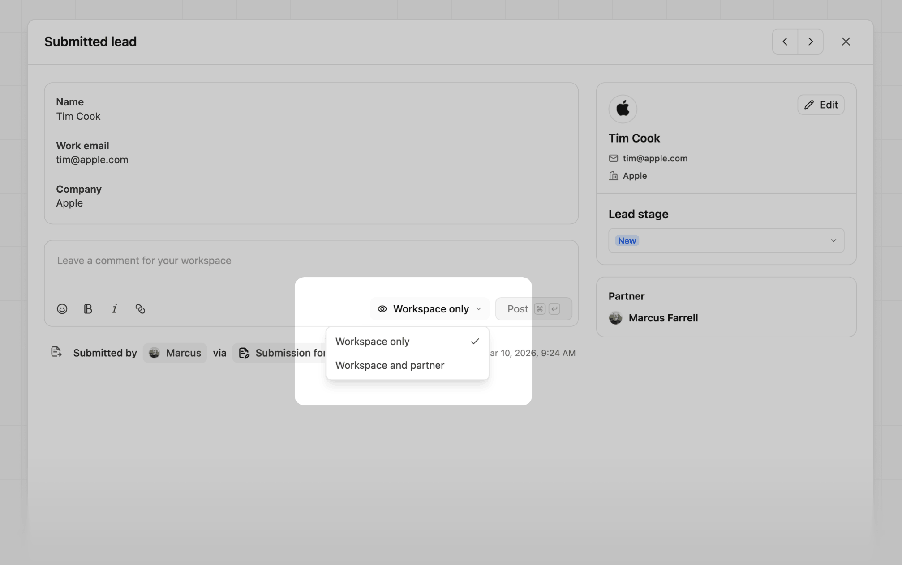
</Frame>

Partner can reply to a submitted lead from their partner dashboard. Their comments are always visible to your workspace and show a **Partner** badge next to their name.

<Frame>
  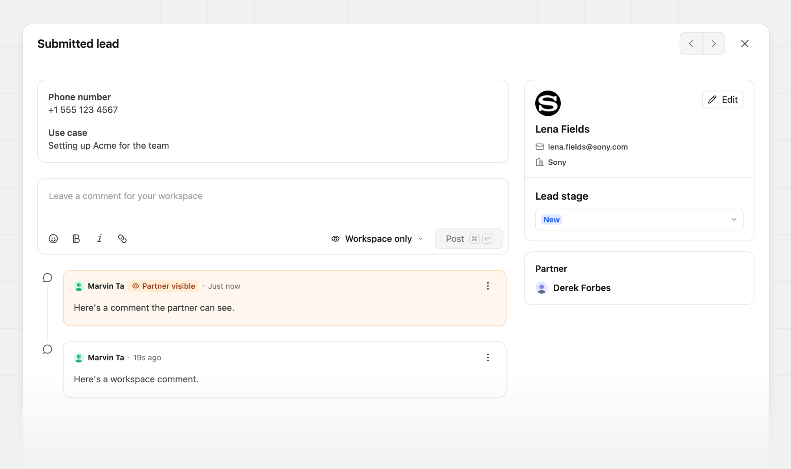
</Frame>

## Submitted lead statuses

Submitted leads move through a simple pipeline inside Dub:

| Status          | What it means                                                                  |
| --------------- | ------------------------------------------------------------------------------ |
| **New**         | The lead was submitted and has not been reviewed yet.                          |
| **Qualified**   | The lead is valid and worth pursuing. This also creates a lead event + reward. |
| **Meeting**     | The lead prospect has progressed to a meeting stage.                           |
| **Negotiation** | The lead prospect is in an active deal cycle.                                  |
| **Unqualified** | The lead is not a fit and will not move forward.                               |
| **Closed won**  | The lead became a customer. This also creates a sale record.                   |
| **Closed lost** | The opportunity did not convert.                                               |

- All submitted leads start in **New**
- **Unqualified**, **Closed won**, and **Closed lost** are final states
- You can move submitted leads forward or backward between **Qualified**, **Meeting**, and **Negotiation**
- A submitted lead must have an associated customer before it can be moved to **Closed won**

In practice, that means you should typically mark a submitted lead as **Qualified** before marking it as **Closed won**.

## Updating lead statuses

If you select a new stage, Dub shows **Save changes** and **Cancel** actions at the bottom of the drawer before the update is finalized.

<Frame>
  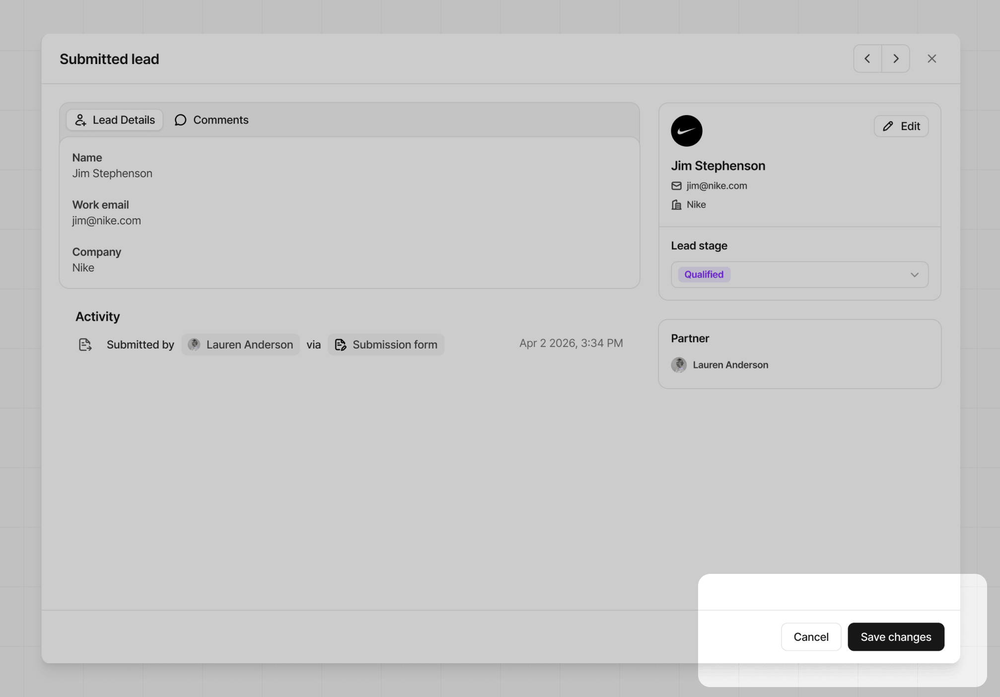
</Frame>

For all status change updates, the partner is notified and the status change is reflected in their dashboard. You can also include optional notes for the partner with the status update. For `qualified` and `closed won` statuses, additional information may be shown or required.

### Qualified status

This change will also ask for an optional external ID.

<Frame>
  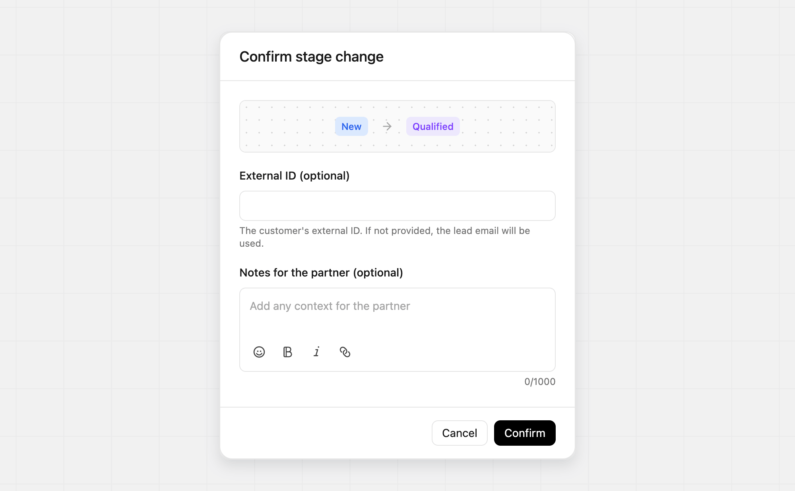
</Frame>

When changing to `qualified`, this creates a lead event.

### Closed won status

This change will also ask for a required sale amount and optional Stripe customer ID.

<Frame>
  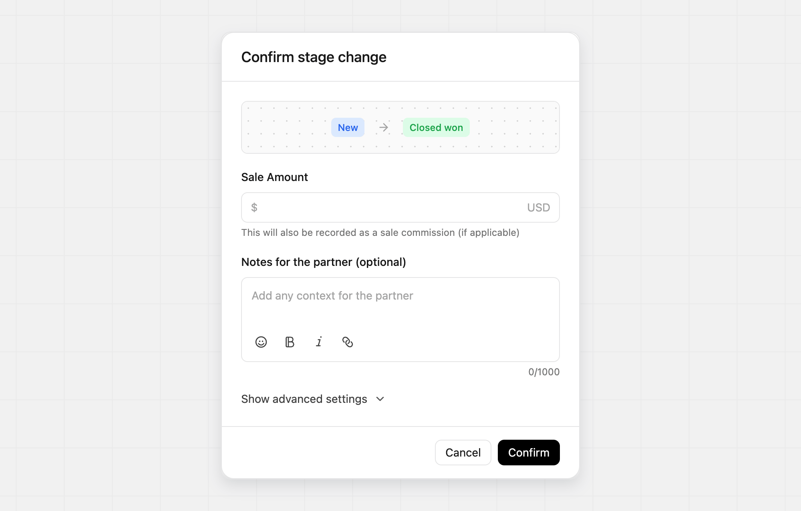
</Frame>

When changing to `closed won`, this creates a sale record.
